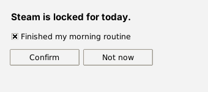
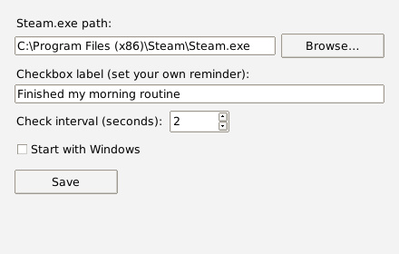
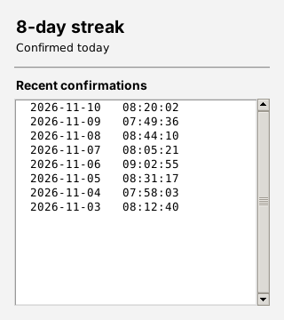

<h1> reminder-gate</h1>

**A small Windows app that gates Steam until you check off a daily reminder.**

reminder-gate sits in your system tray. When you open Steam and you haven't confirmed your daily check yet, it sends the Steam window back to the tray and shows a simple checkbox prompt. Confirm once and you're good for the rest of the day. It resets at midnight (your local time).

The checkbox text is whatever you want it to be — set it in Settings.

> This is a self-accountability tool, not a lock. You can always quit reminder-gate from the tray.

---

## How it works

1. reminder-gate runs in your **system tray** (near the clock).
2. It watches for the **Steam window** to open. It never kills the Steam process, so Steam can keep running in the background and **download updates as normal**.
3. If you open Steam and haven't confirmed today, reminder-gate sends the window back to the tray and shows a prompt.
4. Tick the checkbox and click **Confirm**. The Steam window reopens and stays unlocked for the rest of the day.
5. Click **Not now** or close the prompt and Steam stays in the tray. Open it again later and you'll get the prompt again.

If Steam is already open when midnight passes, it's left alone. The new day's check applies the next time you open Steam.

---

## Screenshots

| Prompt | Tray menu | Settings | History |
|:-:|:-:|:-:|:-:|
|  |  |  |  |

---

## Install

### Option A — Download the `.exe`

1. Go to [Releases](../../releases).
2. Download **reminder-gate.exe**.
3. Put it somewhere (e.g. `C:\reminder-gate\`).
4. Double-click to run. A lock icon appears in your tray.

> **"Windows protected your PC"?** The `.exe` isn't code-signed, so SmartScreen (and sometimes antivirus) may warn you. Click **More info → Run anyway**, or build it from source yourself (Option C).

### Option B — Run from source

Requires [Python 3.11+](https://www.python.org/downloads/). Dependencies: `pystray`, `Pillow` (and `pyinstaller` for building).

```
git clone https://github.com/YOUR_USERNAME/reminder-gate.git
cd reminder-gate
python -m venv .venv
.venv\Scripts\activate
python -m pip install -r requirements.txt
python run_remindergate.pyw
```

Run these commands in Command Prompt. In PowerShell, activate the environment with `.\.venv\Scripts\Activate.ps1`; in Git Bash, use `source .venv/Scripts/activate` instead.

### Option C — Build the `.exe` yourself

```
python -m venv .venv
.venv\Scripts\activate
python -m pip install -r requirements.txt
build.bat
```

Output: `dist\reminder-gate.exe`

---

## Start with Windows

**From the app:** Tray icon → Settings → check **Start with Windows** → Save.

**Manually:** Press `Win+R`, type `shell:startup`, drop a shortcut to `reminder-gate.exe` in that folder.

It doesn't matter whether Steam or reminder-gate starts first. Steam can start with Windows and update in the background; you will only be prompted when you open the Steam window.

---

## Tray menu

Right-click the tray icon:

| Item | What it does |
|---|---|
| Unlock now | Opens the confirmation prompt without waiting for Steam |
| Settings | Steam path, checkbox text, check interval, Start with Windows |
| History | Your streak and past confirmations |
| Quit | Closes reminder-gate |

---

## Settings

| Setting | What it does | Default |
|---|---|---|
| Steam.exe path | Fallback used to reopen Steam if the `steam://` link doesn't work | `C:\Program Files (x86)\Steam\Steam.exe` |
| Checkbox label | The text on the confirmation checkbox — set it to whatever you want | *I completed my daily check* |
| Check interval | Seconds between checks (1–30) | 2 |
| Start with Windows | Auto-launch at login | Off |

Config file: `%APPDATA%\reminder-gate\config.json`

---

## History

Right-click the tray icon → **History** to see your current streak and a log of past confirmations (date + time only — nothing else is stored).

---

## Privacy

reminder-gate stores nothing about *what* you're confirming — just dates and times. No network requests, no telemetry, no accounts. Everything lives locally in `%APPDATA%\reminder-gate\`.

---

## Troubleshooting

**The prompt doesn't appear when I open Steam.**
reminder-gate looks for a visible window titled `Steam` owned by `steamwebhelper.exe`. With Steam open, run this from the project folder to see what it detects:

```
python -m remindergate.watcher
```

The Steam main window should be marked `<-- Steam main window`. If it isn't, open an issue with the output.

**Steam fully exits instead of going to the tray.**
reminder-gate closes the window the same way clicking the X does. If your Steam is set up to exit on close, it will exit. Background downloads only continue if Steam stays in the tray.

**Logs:** `%APPDATA%\reminder-gate\remindergate.log`

---

## Project structure

```
reminder-gate/
├── remindergate/
│   ├── __init__.py      # version
│   ├── config.py        # JSON config + history
│   ├── watcher.py       # background Steam window watcher
│   ├── ui.py            # prompt, settings, history windows (native ttk)
│   └── tray.py          # system tray icon (pystray)
├── run_remindergate.pyw  # entry point (no console)
├── build.bat             # build to .exe
├── requirements.txt
├── LICENSE
└── README.md
```

---

## Contributing

PRs welcome. Ideas:

- [ ] Also gate games launched from desktop shortcuts (without opening the Steam window)
- [ ] Block any app, not just Steam (configurable list)
- [ ] Multiple daily checks (morning + evening)
- [ ] Export history to CSV
- [ ] macOS / Linux support

---

## License

[MIT](LICENSE)
